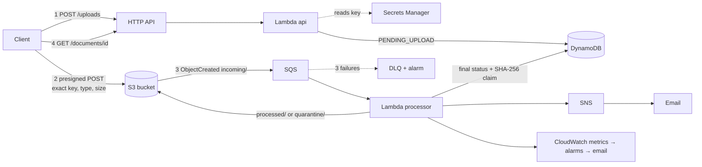

# Project 2 — Serverless Document Workflow (DocFlow for BrightMart)

Arrowstack Cloud Computing Internship · Intermediate Real-World Task

A serverless intake pipeline for supplier documents (invoices, delivery notes, stock counts) at **BrightMart**, the
fictional retailer from Project 1. Files are uploaded straight to S3 and queued. A Lambda checks the real file type,
extracts metadata and invoice fields, catches duplicates and quarantines anything bad. Metadata is stored in DynamoDB,
and every outcome is emailed through SNS. All of it is defined in one CloudFormation template.

| | |
|---|---|
| **Stakeholder** | BrightMart Accounts Payable (primary), store receiving staff (uploaders), finance controller |
| **Problem** | Invoices arrive as email attachments and are keyed in by hand. Files get lost, re-sent invoices get paid twice, and attachments are opened unchecked |
| **Solution** | Upload → automatic check, classification, invoice number/total extraction, duplicate detection, filing and notification within seconds |
| **Stack** | Python 3.12 · AWS Lambda (arm64) · API Gateway HTTP API · S3 (presigned POST, versioning) · SQS + DLQ · DynamoDB (on-demand, PITR) · SNS · Secrets Manager · CloudWatch (EMF metrics, alarms, dashboard) · AWS Budgets · CloudFormation |

> **Status (2026-10-31):** deployed to AWS (ap-south-1). **Cloud smoke test 26/26 PASS**, end-to-end p50 **1.2 s**.
> 84 tests, 94% coverage, local demo 14/14, cfn-lint clean. See [docs/test-evidence.md](docs/test-evidence.md).

## Architecture



More detail (sequence, states, data model, IAM, failure handling, limitations): [docs/architecture.md](docs/architecture.md)

## How each requirement is covered

| Handbook requirement | Implementation | Evidence |
|---|---|---|
| IAM least privilege | One role per function. S3 access scoped **by prefix** (api: sign PUT `incoming/*`, GET `processed/*`; processor: read/delete `incoming/*`, write `processed/*` + `quarantine/*`). Exactly one table, queue, topic, secret and log group each. No `*` resources | [infra/template.yaml](infra/template.yaml) `ApiFunctionRole`, `ProcessorFunctionRole` |
| Configuration / secrets management | All config via env vars set by CloudFormation. The API key is generated in Secrets Manager. Lambda gets only the ARN and caches the value for 5 min, so rotation needs no redeploy | [src/docflow/config.py](src/docflow/config.py), `test_api_key_comes_from_secrets_manager` |
| Monitoring / logging | JSON logs with request ID. EMF metrics (processed/rejected/duplicate, processing and end-to-end latency). 5 alarms (DLQ, backlog, processor errors, API 5xx, rejection spike). Dashboard. API access logs | [docs/operations-runbook.md](docs/operations-runbook.md) |
| Backup / recovery plan | S3 versioning (30 days), DynamoDB PITR (35 days), DLQ (14 days) + redrive, on-demand backup at teardown, restore runbook with RPO/RTO and a drill | [docs/operations-runbook.md#backup--recovery](docs/operations-runbook.md#backup--recovery) |
| Cost-awareness notes | Pay-per-use only, arm64, concurrency and throttle caps, lifecycle rules, 14-day log retention, $5 budget | [docs/cost-notes.md](docs/cost-notes.md) |
| Edge cases / invalid input | 422 with all field errors. Path traversal / Unicode filenames. Exact-size and type POST policy. Magic-byte type check (EXE/ZIP/ELF/script blocked). Truncated/encrypted PDF, damaged images, non-UTF-8 text, bad CSV. Duplicates. Unregistered uploads. Redelivery. Crash mid-processing. Poison messages | [tests/](tests/), [docs/test-evidence.md](docs/test-evidence.md) |

## Run locally (no AWS needed)

```bash
python -m venv .venv
.venv\Scripts\activate            # Windows  (macOS/Linux: source .venv/bin/activate)
pip install -r requirements-dev.txt
pytest --cov=docflow              # 84 tests, 94% coverage (AWS mocked with moto)
python scripts/local_demo.py      # full workflow in moto: 14 checks, report in evidence/
python scripts/make_samples.py    # regenerates samples/
```

## Deploy to AWS (on hold — see RUN-GUIDE.md)

**Prerequisites:** AWS CLI v2 configured with `aws configure`, and the venv above (for the smoke test). Docker and SAM
are **not** needed.

```powershell
.\scripts\deploy.ps1 -AlertEmail you@example.com
```

1. Takes about 3 minutes. Confirm **both** SNS emails (document events and alarms).
2. Run the end-to-end check against the deployed stack:
   ```powershell
   $api = aws cloudformation describe-stacks --stack-name docflow --region ap-south-1 --query "Stacks[0].Outputs[?OutputKey=='ApiUrl'].OutputValue" --output text
   $key = aws secretsmanager get-secret-value --secret-id docflow/api-key --region ap-south-1 --query SecretString --output text
   .venv\Scripts\python scripts\smoke_test.py --base-url $api --api-key $key
   ```
3. Upload one file and watch the result: `.venv\Scripts\python scripts\upload.py --base-url $api --api-key $key samples\INV-2026-0042.pdf`

| Task | Command |
|---|---|
| Ship new code or template changes | `.\scripts\deploy.ps1 -AlertEmail ...` (repackages only what changed) |
| Tear everything down | `.\scripts\teardown.ps1` (DynamoDB backup → empty bucket → delete stack) |

> ⚠️ **Delete the stack when you're done demoing.** Idle cost is ~$0.40/month (the secret), but the bucket holds uploaded files.

## API summary

| Method | Path | Auth | Purpose |
|---|---|---|---|
| GET | `/health` | – | Liveness |
| POST | `/uploads` | API key | Register a file `{filename, content_type, size_bytes, uploaded_by}` → `201 {document_id, upload: {url, fields}}` |
| *(S3)* | `upload.url` | presigned | `multipart/form-data` POST of `upload.fields` + `file` → `204` |
| GET | `/documents/{id}` | API key | Status, reason, class, metadata, extracted fields, `download_url` (5 min) when processed |
| GET | `/documents?status=PROCESSED&limit=20&next_token=` | API key | Newest first, paginated. Status = PENDING_UPLOAD / PROCESSED / REJECTED / DUPLICATE |

Accepted: PDF, PNG, JPEG, UTF-8 TXT/CSV, 1 B – 10 MiB.

## Repository layout

```
src/docflow/        Lambda code: api_handler, processor_handler, inspector, validation, repository, config, aws, observability
tests/              pytest suite (moto: S3, SQS, DynamoDB, SNS, Secrets Manager) + sample-file builders
infra/template.yaml CloudFormation: S3, SQS+DLQ, DynamoDB, 2 Lambdas, HTTP API, IAM, SNS, alarms, dashboard, budget
scripts/            deploy / teardown / smoke_test / upload / local_demo / make_samples / empty_bucket
samples/            demo files: 4 valid, 1 duplicate, 4 edge cases (simulated data)
docs/               requirements, architecture, decisions, runbook, cost notes, test evidence, work log, presentation
evidence/           pytest report, cfn-lint output, local demo report (cloud smoke reports go here too)
```

## Known limitations

No OCR (fields only from text/uncompressed PDFs), no antivirus scanning, one shared API key, byte-exact duplicates
only, default API URL with no WAF, single region. Each has a roadmap item in
[docs/architecture.md#limitations--roadmap](docs/architecture.md#limitations--roadmap).
