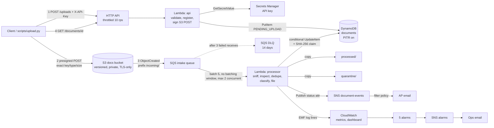
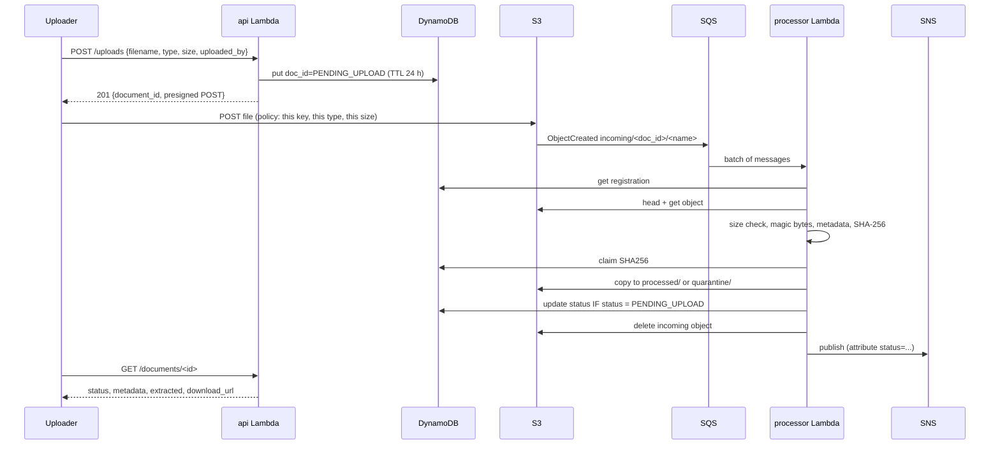
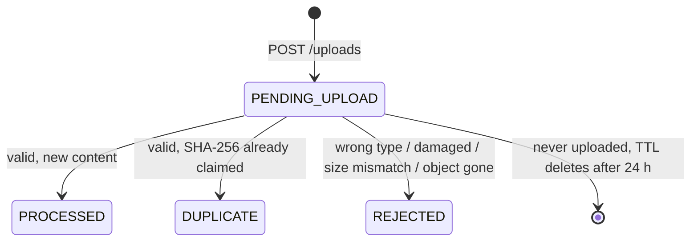

# Architecture — DocFlow

## Overview

The file bytes never pass through API Gateway or Lambda on the way in. The client sends them straight to S3 using a
presigned POST that S3 itself enforces (key, `Content-Type`, exact `content-length-range`). This avoids API Gateway's
10 MB and Lambda's 6 MB payload limits, and no Lambda time is spent copying bytes.

## Request sequence

## Document states

Final states never change. The conditional update (`status = PENDING_UPLOAD`) makes sure of that even when SQS
delivers the same event twice.

## Data model (DynamoDB `docflow-documents`, on-demand)

| Item | Key | Main attributes |
|---|---|---|
| Document | `doc_id` = UUID | `status`, `filename`, `original_filename`, `content_type`, `size_bytes`, `uploaded_by`, `source_ip`, `created_at`, `updated_at`, `processed_at`, `incoming_key`, `storage_key` / `quarantine_key`, `sha256`, `detected_type`, `metadata{}`, `doc_class`, `extracted{invoice_number, total_amount_minor, currency}`, `reason`, `duplicate_of`, `processing_ms`, `expires_at` (pending only) |
| Hash claim | `doc_id` = `SHA256#<hex>` | `owner_doc_id`, `created_at` |

GSI `by_status` (`status`, `created_at`) serves `GET /documents?status=` newest-first. Claim items have no `status`
attribute, so they never appear in it (a sparse index).

## S3 layout (one bucket)

| Prefix | Written by | Lifecycle |
|---|---|---|
| `incoming/<doc_id>/<name>` | client (presigned POST) | expires after 1 day (abandoned uploads). Normally emptied within seconds |
| `processed/<yyyy>/<mm>/<doc_id>/<name>` | processor | → Standard-IA after 90 days |
| `quarantine/<doc_id>/<name>` and `quarantine/unregistered/...` | processor | expires after 30 days |
| (all) | | non-current versions expire after 30 days; incomplete multipart uploads after 1 day |

The S3 → SQS notification is filtered to `incoming/`, so the processor's own writes never trigger it again (no loops).

## Security & IAM

| Control | How |
|---|---|
| Least privilege | **Two roles**. `api` can PutItem/GetItem/Query the table, sign PUTs into `incoming/*` only, sign GETs from `processed/*` only, read one secret, and write its own log group. `processor` can read/delete `incoming/*`, write `processed/*` and `quarantine/*`, ListBucket (needed for 404 instead of 403), Get/Put/UpdateItem, publish to one topic, consume one queue, and write its own log group. No wildcards on resources |
| Secrets | The API key is generated by Secrets Manager at deploy time. Lambda gets only its ARN and caches the value for 5 min, so a rotation is picked up without a redeploy |
| Data protection | Bucket: Block Public Access ×4, BucketOwnerEnforced (no ACLs), SSE-S3, deny non-TLS. SQS: SSE-SQS. DynamoDB: encrypted at rest. Download links are presigned and expire after 5 min |
| Input safety | Size/type/key locked in the S3 POST policy. Real type checked from bytes (executables, ZIP/Office, ELF, Java class and scripts are blocked). Filenames sanitised. Key comparison is constant-time. Errors never return internals (500 carries only a request ID) |
| Abuse/cost | HTTP API throttle 10 rps / burst 20. Processor concurrency capped at 2. Budget alert at 80% |
| Audit | Every request logged with request ID, path, status, latency, source IP. API Gateway access logs. Each record keeps uploader, IP and timestamps |

## Failure handling

| Failure | Behaviour |
|---|---|
| Processor crashes mid-document | The message is reported as a failed batch item and retried. The copy-then-conditional-write-then-delete order means a retry finishes the job. The hash claim recognises its own `doc_id`, so the retry is not marked DUPLICATE (tested) |
| Same S3 event delivered twice | The second run sees a final status, deletes any leftover `incoming/` object and stops. No second email (tested) |
| Poison message (unparseable) | Only that message fails (ReportBatchItemFailures). After 3 receives it moves to the DLQ, and the `dlq-not-empty` alarm emails ops |
| SNS publish fails | Logged as an error. The document stays filed. Not retried, so it is not reprocessed (tested) |
| Metrics code fails | Logged. Does not fail the message (found and fixed during testing, see worklog) |
| Processor down / throttled | Messages wait in SQS (4-day retention). The `intake-backlog` alarm fires if the oldest is > 5 min old |
| Upload never happens | The pending record expires through DynamoDB TTL after 24 h. The `incoming/` lifecycle cleans any partial object |
| File put in `incoming/` directly | Quarantined under `quarantine/unregistered/`, REJECTED email sent (tested) |

## Scaling to 10× (viva question)

All components are managed and scale on demand. To scale, raise `MaximumConcurrency` on the queue trigger (currently 2)
and the API throttle. DynamoDB on-demand absorbs the writes. Practical next steps at 10×: cursor-based pagination is
already in place; add an S3 "Requester" index by uploader; move duplicates and classification into a Step Functions
workflow if OCR is added (Textract is asynchronous); consider provisioned DynamoDB capacity once traffic is steady,
because it is cheaper then.

## Limitations & roadmap

| Limitation | Why accepted now | Roadmap |
|---|---|---|
| No OCR: invoice fields come only from text files and uncompressed PDF text | Textract is not free-tier and the free-plan account may block it | Textract `AnalyzeExpense` behind a feature flag, Step Functions for the async call |
| No antivirus scan, only content-type allow-listing | GuardDuty Malware Protection costs per GB scanned | Enable GuardDuty Malware Protection for S3 on `incoming/` and wait for its scan tag |
| One shared API key, no per-user identity | Proportionate for an internal prototype | Cognito user pool + JWT authorizer on the HTTP API; uploader taken from the token, not the body |
| Duplicate detection is byte-exact only | Perceptual/near-duplicate matching needs OCR | Match on (supplier, invoice_number, total) once OCR exists |
| Default `execute-api` URL, no custom domain/WAF | Cost and scope | Custom domain + ACM certificate, AWS WAF rate rules |
| Single region | Cost | S3 Cross-Region Replication + DynamoDB global table for DR |
| A crash between the DynamoDB write and the SNS publish loses that one email | At-most-once email is acceptable. Status is always correct in the API | Outbox pattern: DynamoDB Streams → notifier Lambda |
